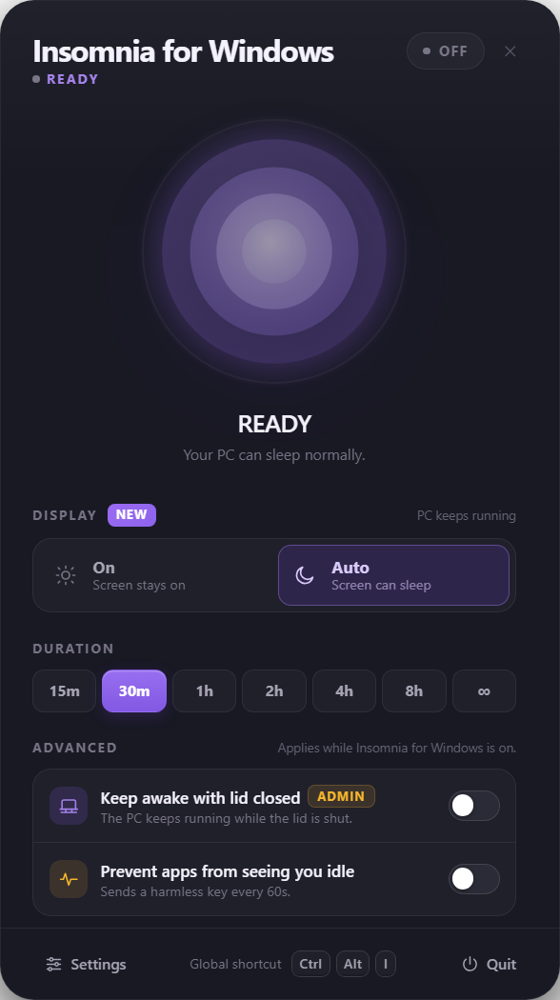
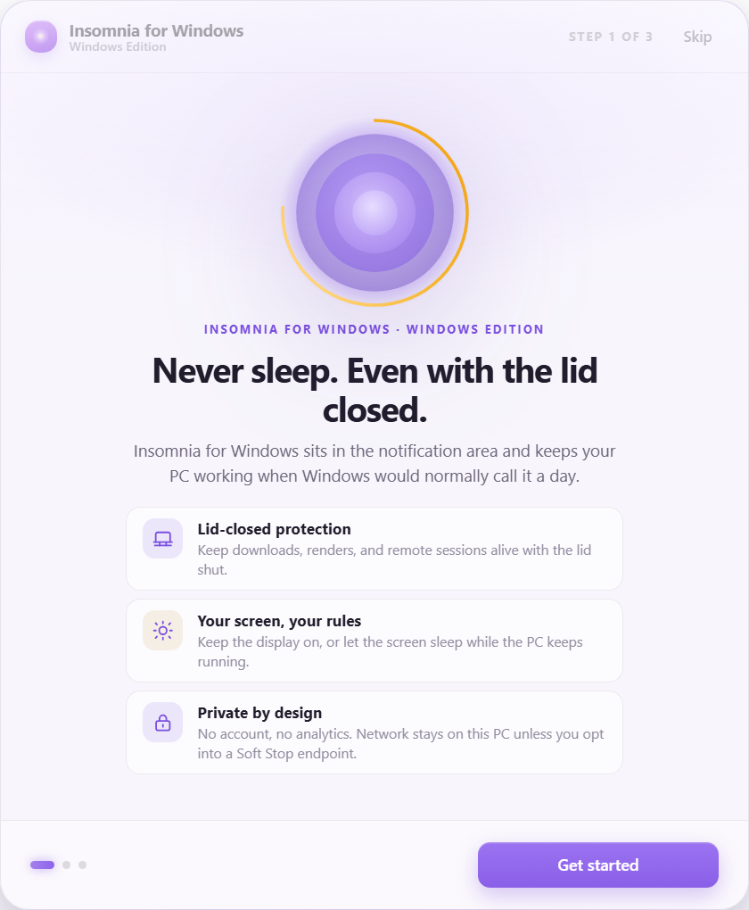

# Insomnia for Windows

> Keep your PC awake — even with the lid closed.
> An independent Windows port of the macOS menu-bar app **InsomniaZ – Never Sleep**. Not affiliated with the original author.

**English** · [中文](README.zh-CN.md)

<p align="center">
  
  
</p>

A tray-first app: no window takes a taskbar slot, closing a window only hides it, and quitting is
done from the tray. Everything the original menu-bar icon did with click, long-press and right-click
now lives in the tray: left-click opens the control panel, right-click opens the full native menu,
long-pressing the status ring opens Settings.

- **1.1.0** added **Soft Stop**: at battery threshold A it sends a fixed prompt to the AI that is
  still running; at the lower threshold B it ends the session and sleeps protectively. Local
  runtimes, OpenAI-compatible endpoints, webhooks, CLI, plus GUI recognition and mouse teaching for
  apps without an API.
- **1.2.0** is a maintenance release: every user-facing document is now available in English and
  Chinese, and the historical design, acceptance and review records were moved into one archive
  folder.

## Download

Installers and the portable build are published on [GitHub Releases](../../releases/latest).

| File | Description |
|---|---|
| `InsomniaZ-Windows-1.2.0-x64.exe` | Installer (recommended). Per-user, choosable install directory, Start-menu and desktop shortcuts. |
| `InsomniaZ-Windows-1.2.0-portable.exe` | Portable. One exe, no install directory; settings still live in `%APPDATA%\InsomniaZ\`. |
| `SHA256SUMS.txt` | SHA-256 of both binaries — verify after downloading. |

- Requirements: Windows 10 22H2 or Windows 11, x64.
- The binaries are **not code-signed**, so SmartScreen may say "unknown publisher". Verify the
  SHA-256 first, then choose "More info → Run anyway".
- Lid-close protection needs administrator approval. Declining UAC does not affect the other
  keep-awake features; the UI clearly marks lid protection as unavailable.
- The app does not phone home and does not check for updates. It only contacts a remote address
  when you explicitly enable a remote Soft Stop endpoint. New versions must be downloaded manually.

## Features

### Keep-awake core

- **Sleep prevention** — Electron `powerSaveBlocker` plus `SetThreadExecutionState` in the elevated
  helper, two independent layers.
- **Run with the lid closed** — temporarily sets the current power scheme's lid action to "do
  nothing" (AC and DC). The original value is backed up before writing and read back after; it is
  restored on exit or crash, and an abnormal restart prompts to recover it next launch.
- **Display mode** — `On` keeps the screen lit; `Auto` lets the screen sleep while the system runs.
- **Timed sessions** — 15 m / 30 m / 1 h / 2 h / 4 h / 8 h / ∞, ending automatically. An unexpired
  session can be resumed after a crash (lid permission is never silently restored).
- **Advanced mode** — sends a harmless F15 keypress every 30–300 s so Teams, Slack and similar do
  not mark the machine idle.
- **Low-battery protection** — 20% by default, configurable 5–95%, optionally "stop on battery".
- **Global shortcut** — `Ctrl+Alt+I` by default; record your own, restore the default, and get an
  explicit warning on conflict.
- **Full tray menu** — toggle, duration, display mode, lid protection, activity simulation, panel,
  settings, about, compatibility check, quit.
- **Appearance and language** — English/Chinese, dark/light/system, compact layout, notifications.

### Soft Stop (1.1.0)

Two battery thresholds. At A, if an AI is genuinely still working, a fixed prompt is sent; at B the
session ends, the lid policy is restored and Windows sleeps. Detection covers wireless/cellular
streaming and local AI runtimes; sending covers local runtimes, OpenAI-compatible endpoints,
webhooks, CLI and a GUI fallback. Apps without an API are driven through UI Automation, with
dry-run preview, a whitelist and first-run confirmation. Teaching records **only mouse clicks and
hovers — never typed text**. See the [Soft Stop guide](docs/soft-stop.md).

## Interaction mapping

| macOS menu bar | Windows |
|---|---|
| Left-click opens the popover | Left-click the tray icon opens the control panel (can be disabled) |
| Right-click menu | Right-click the tray icon opens the full native menu |
| Icon tint / grey-out | `tray-active.png` / `tray-idle.png`; tooltip shows remaining time |
| No Dock icon | All windows use `skipTaskbar` |
| Long-press the status ring | Hold the ring for 550 ms to open Settings |
| Global shortcut | `Ctrl+Alt+I` toggles the session |
| — | Closing Settings brings the control panel back |

## Usage

1. Run the installer, or just run the portable exe.
2. First launch shows a three-step onboarding; afterwards the app lives in the tray.
3. Left-click the tray icon for the panel, right-click for the full menu.
4. Click the status ring or capsule to start/stop; picking a duration starts the timer immediately.
5. To keep running with the lid closed, enable "Keep running with lid closed" and approve UAC.
6. Settings → Soft Stop: enter the fixed stop prompt and thresholds A/B; verify the target with
   dry-run and **Send a test prompt** first.
7. For chat apps without an API: enable the GUI fallback, whitelist the process, preview with
   **Scan windows**, then decide whether to allow unattended sending.
8. When the dictionary misreads an app, use **Start recording**: click the input box, hover the send
   button, stop, then confirm or edit the suggested labels and save the profile.
9. Closing the panel only hides it. To quit, use the panel's Quit button or the tray menu.

## Why administrator rights are needed

Windows has no "don't sleep on lid close" switch for ordinary apps; the only way is to change
`LIDACTION` in the current power scheme, which requires elevation. This project installs no service
and no scheduled task. The elevated helper runs only while lid protection is on:

- it is launched through UAC only when you enable lid protection;
- it accepts a fixed command set over a randomly named pipe with a random token and parent watching;
- when the parent exits or crashes, it restores the original lid policy and exits;
- after an abnormal restart, the next launch asks to recover the unrestored policy (UAC again);
- a normal exit deletes `%APPDATA%\InsomniaZ\lid-recovery.json`.

If you decline UAC, sleep prevention, display mode, timers and shortcuts still work — only lid
protection is unavailable.

## Privacy and security

- Settings, sessions and logs live in `%APPDATA%\InsomniaZ\`. No other registry location is written
  (except startup, which you enable yourself).
- The original lid value is backed up to `lid-recovery.json` and deleted on normal exit.
- Diagnostics export contains only version, power capability, state and logs, and is user-triggered.
- No remote requests by default. Soft Stop only contacts loopback endpoints; remote endpoints
  require an explicit opt-in.
- API keys are DPAPI-encrypted. Logs and audits never contain keys or prompt text.
- AI detection reads only process names, ports, adapters and throughput. Teaching installs no
  keyboard hook and records no typed content. Screenshots are taken only on explicit opt-in, and
  only of the selected window.
- The renderer uses `contextIsolation`, `sandbox`, no `nodeIntegration` and a strict CSP; DevTools
  are disabled in production.

Full policy: [SECURITY.md](SECURITY.md) · [中文](SECURITY.zh-CN.md).

## Verification status

Current 1.2.0 baseline on Windows 10 22H2 (19045, x64):

| Item | Result |
|---|---|
| Type check (main + renderer + tests) | Pass |
| Vitest unit/integration | **307 tests in 24 files pass** — real helper processes, real HTTP sockets, the Soft Stop state machine, GUI recognition and the teaching recorder |
| Production build (main + renderer + both helpers) | Pass |
| Real Electron smoke | **44/44 pass** on 1.2.0 (2026-11-07) — real interaction against the live desktop |
| Load / stress run | **12/12 pass** — 3-minute window under two saturated CPU processes, 36 samples, largest gap 5.1 s, 36 settings writes with the file parseable throughout, power helper connected throughout, session file removed on deactivate. Peak app-tree RSS 486 MB, peak app CPU 8.6% |
| Packaged binaries | **Rebuilt on 2026-11-09 after the rename** — version 1.2.0, `ProductName: Insomnia for Windows`, unsigned; `sha256sum -c` passes. The 2026-11-08 launch check applies to the pre-rename build; the post-rename live launch re-check is pending until the running instance is closed |
| Protective sleep | Implemented and unit-tested; **not executed on the real machine**, to avoid interrupting running work |
| Lid policy write/restore | Elevation, write and exit-restore verified on real hardware; physical lid close untested |

Historical evidence for 1.0.0/1.1.0 (58 + 149 unit tests, 37/44 smoke checks, a real GUI send with a
byte-identical payload, teaching with `leakedPrompt=false`) is kept in the
[design archive](design-archive/README.md).

## Known limitations

- **Physical lid close untested** — elevation, policy write and exit-restore are verified, but the
  lid was never actually closed, nor was AC unplugged while closed.
- **Protective sleep never executed on real hardware** — verify the local path with **Sleep now**
  while attending the machine.
- **GUI recognition depends on accessibility** — pure-canvas apps with no UIA/MSAA cannot be read;
  minimised windows must be restored; elevated apps need equal elevation. A target-app redesign can
  break ratio anchors and OCR labels.
- **Remote endpoints leave this machine** — once enabled, prompts and battery level go to the
  service you configured; evaluate its privacy policy yourself.
- **Not code-signed** — SmartScreen will warn; verify with `SHA256SUMS.txt`.
- **Windows 11 / OEM power schemes not individually covered** — measured on Windows 10 22H2
  Balanced; other schemes use the same Power API path.
- **Notification visuals unconfirmed** — whether Action Center shows them, or Focus Assist blocks
  them, depends on machine policy.
- **Installer startup not reboot-verified** — the setting exists; the portable build deliberately
  does not support startup.
- **NSIS install/uninstall not tested on a clean system** — installers are generated from an
  accepted `win-unpacked` directory.
- **Memory above the design target** — idle ≈213 MB (app 186 MB + helper 27 MB) versus a 160 MB
  goal; idle CPU 0–0.16%. Under a sustained saturated-CPU load the process tree climbed to ≈486 MB
  and stayed flat afterwards. This is the Electron 38 three-process baseline.
- **Multi-monitor / Modern Standby are best-effort** — the panel follows the cursor's monitor work
  area; measured on a single display at 150% scaling.
- **UI replication boundary** — the official app provided only five store screenshots; Settings,
  onboarding and some states are reasonable inferences in the same design language, not
  pixel-exact copies.

## Development

Requires Node.js 22+ and npm 10+. Windows builds also need the built-in .NET Framework 4.8 compiler
(`csc.exe`) for both helpers.

```bash
npm install
npm run dev        # Vite + Electron hot reload
npm run typecheck  # main + renderer + tests
npm test           # Vitest unit/integration
npm run build      # main + renderer + both helpers
npm start          # production build, then launch
npm run capture    # regenerate docs/captures screenshots
npx electron . --smoke        # real-interaction smoke (build first)
npx electron . --smoke-fresh  # fresh-user-data first-run smoke
npx electron . --stress        # load run: long session under CPU load, writes docs/stress.json
npm run dist       # NSIS + portable into release/
```

> `capture` and `--smoke` run against the real desktop and can touch the system power policy.
> Do not run them while a lid-protected session is active.

<details>
<summary>Packaging on offline / mirrored networks</summary>

`electron-builder` downloads Electron and NSIS resources from GitHub by default. On a restricted
network, set a mirror and follow "directory package → write icon/version info → build installers":

```bash
export ELECTRON_BUILDER_BINARIES_MIRROR=https://npmmirror.com/mirrors/electron-builder-binaries/
npm run build
npx electron-builder --win --dir --x64 \
  --config.directories.output=build-out --config.win.signAndEditExecutable=false
.tools/winCodeSign/rcedit-x64.exe "build-out/win-unpacked/Insomnia for Windows.exe" \
  --set-icon release/.icon-ico/icon.ico \
  --set-version-string FileDescription "Insomnia for Windows" \
  --set-version-string ProductName "Insomnia for Windows" \
  --set-version-string CompanyName "JettLearner" \
  --set-version-string LegalCopyright "Copyright (c) 2026 JettLearner" \
  --set-file-version 1.2.0 --set-product-version 1.2.0.0
npx electron-builder --win nsis portable --x64 --prepackaged build-out/win-unpacked \
  --config.directories.output=build-out-installers --config.win.signAndEditExecutable=false
```

If `release/` is locked by a handle from a previous failed run, use a different
`--config.directories.output`; never reuse a directory with a dead handle. `rcedit-x64.exe` comes
from the winCodeSign package downloaded by electron-builder and is not distributed with the repo.

</details>

## Documentation

| Topic | English | 中文 |
|---|---|---|
| Soft Stop guide | [docs/soft-stop.md](docs/soft-stop.md) | [docs/soft-stop.zh-CN.md](docs/soft-stop.zh-CN.md) |
| Release notes 1.2.0 | [docs/release-notes-v1.2.0.md](docs/release-notes-v1.2.0.md) | [docs/release-notes-v1.2.0.zh-CN.md](docs/release-notes-v1.2.0.zh-CN.md) |
| Publishing checklist | [docs/publishing.md](docs/publishing.md) | [docs/publishing.zh-CN.md](docs/publishing.zh-CN.md) |
| Security policy | [SECURITY.md](SECURITY.md) | [SECURITY.zh-CN.md](SECURITY.zh-CN.md) |
| Historical design, acceptance and review records | [design-archive/](design-archive/README.md) | same |
| Screenshots | [docs/captures/](docs/captures) | same |

## License and attribution

Code is released under the [MIT](LICENSE) license. The **InsomniaZ** name and related trademarks
belong to the original author; this project only describes the porting target and is not affiliated
with them. The UI follows the same design language, but icons and assets are drawn from scratch and
no copyrighted resources from the original app are included.