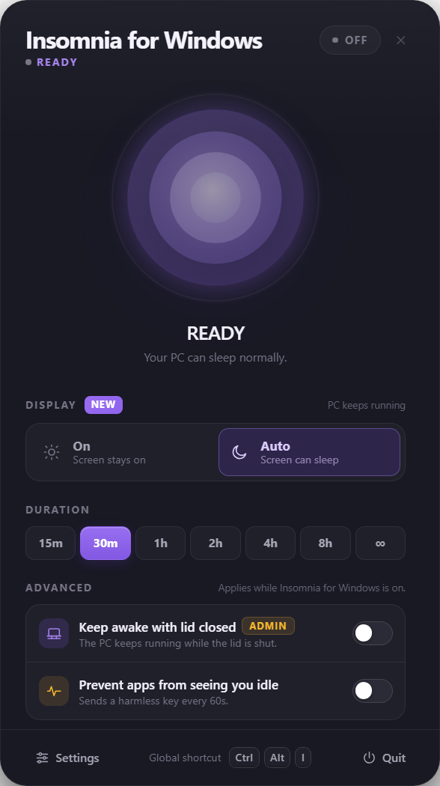
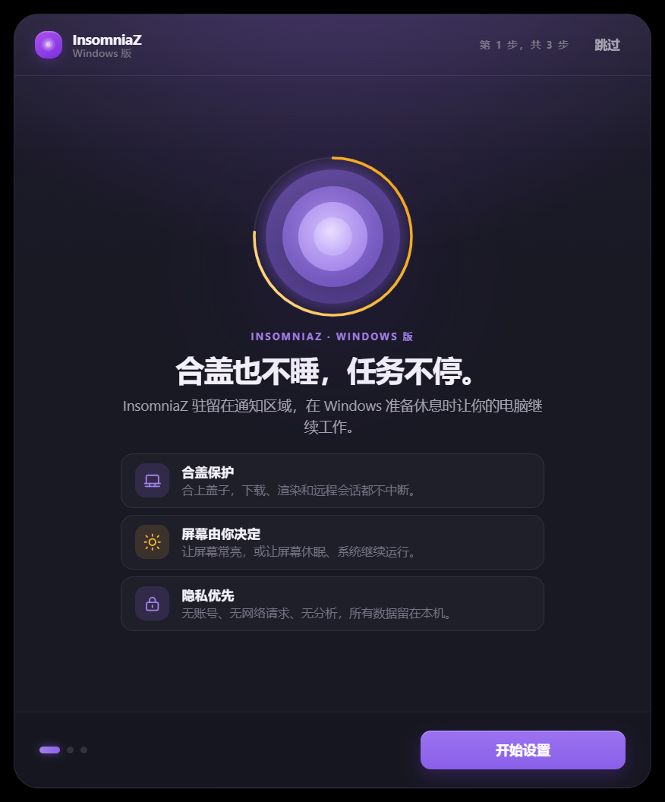

# InsomniaZ for Windows

> 合盖也不睡，任务不停。  
> 对 macOS 菜单栏应用 **InsomniaZ – Never Sleep** 的独立 Windows 移植版，与原作者无关联。

[English](README.md) · **中文**

<p align="center">
  
  
</p>

托盘优先的应用：所有窗口都不占任务栏；关闭窗口只是隐藏，退出由托盘菜单控制。
原菜单栏图标的点击、长按与右键能力全部收进托盘：左键打开控制面板，右键打开完整原生菜单，
长按面板状态环打开设置。

- **1.1.0** 新增 **Soft Stop（软叫停）**：电量到 A 点时给正在运行的 AI 发送固定提示词，
  到更低的 B 点时结束会话并保护性休眠；支持本地运行时、OpenAI 兼容端点、Webhook、CLI，
  以及无 API 应用的 GUI 识别与鼠标示教。
- **1.2.0** 是维护版本：所有面向用户的文档都提供了中英两版，历史设计、验收与评审记录
  统一收进了设计归档目录。

## 下载

安装包与便携版发布在 [GitHub Releases](../../releases/latest)。

| 文件 | 说明 |
|---|---|
| `InsomniaZ-Windows-1.2.0-x64.exe` | 安装版（推荐）。按用户安装，可选择安装目录，创建开始菜单与桌面快捷方式。 |
| `InsomniaZ-Windows-1.2.0-portable.exe` | 便携版。单个 exe 直接运行，不写安装目录；设置仍保存在 `%APPDATA%\InsomniaZ\`。 |
| `SHA256SUMS.txt` | 两个二进制文件的 SHA-256，下载后请核对。 |

- 系统要求：Windows 10 22H2 或 Windows 11，x64。
- 安装包**未做代码签名**，SmartScreen 可能提示“未知发布者”。可先核对 SHA-256，
  再选择“更多信息 → 仍要运行”。
- 合盖保护需要管理员授权；拒绝 UAC 不影响其余防睡眠功能，界面会明确标注合盖保护不可用。
- 应用默认不联网、不检查更新；只有显式启用远程 Soft Stop 端点时，才会访问你配置的地址。
  新版本需要手动下载。

## 功能

### 防睡眠核心

- **防睡眠**：激活时通过 Electron `powerSaveBlocker` 与提权助手的 `SetThreadExecutionState`
  双层保持系统唤醒。
- **合盖继续运行**：把当前电源方案的合盖动作临时改为“不采取任何操作”（AC/DC 同时生效）。
  写入前备份原值，写入后回读校验；退出或崩溃时自动还原，异常重启后会在下次启动时提示恢复。
- **显示模式**：`On` 屏幕常亮；`Auto` 屏幕可关闭、系统继续运行。
- **定时会话**：15 分钟 / 30 分钟 / 1 小时 / 2 小时 / 4 小时 / 8 小时 / ∞；到点自动结束。
  异常退出后可恢复未到期会话（不会静默恢复合盖权限）。
- **高级模式**：按 30–300 秒间隔发送无害的 F15 按键，避免 Teams、Slack 等把电脑判定为空闲。
- **低电量保护**：默认 20%，可配置 5–95%；可选“使用电池时停止”。
- **全局快捷键**：默认 `Ctrl+Alt+I`，可在设置中录制、恢复默认，冲突时明确提示。
- **托盘右键菜单全集**：开关、时长、显示模式、合盖保护、活动模拟、打开面板、
  设置、关于、兼容性检查、退出。
- **外观与语言**：中英双语、深色/浅色/跟随系统、紧凑布局、系统通知开关。

### 软叫停（1.1.0）

两个电量阈值。A 点检测到 AI 确实仍在工作时发送固定提示词；B 点结束会话、还原合盖并休眠。
检测覆盖无线/蜂窝流式传输与本地 AI 运行时；发送支持本地运行时、OpenAI 兼容端点、Webhook、
CLI 与 GUI 兜底。无 API 的聊天应用通过 UI Automation 驱动，可先 dry-run 预览、白名单确认后自动点击。
示教录制**只采鼠标点击与悬停，不记录任何键入文字**。详见 [软叫停指南](docs/soft-stop.zh-CN.md)。

## 交互映射

| macOS 菜单栏 | Windows |
|---|---|
| 左键图标打开 popover | 左键托盘图标打开控制面板（可在设置关闭） |
| 右键菜单 | 右键托盘图标打开完整原生菜单 |
| 菜单栏图标着色/灰显 | `tray-active.png` / `tray-idle.png`，Tooltip 显示剩余时间 |
| 无 Dock 图标 | 所有窗口 `skipTaskbar` |
| 长按状态环 | 面板内按住状态环 550 ms 打开设置 |
| 全局快捷键 | `Ctrl+Alt+I` 切换会话 |
| — | 关闭设置窗口后自动弹回主控制面板 |

## 使用

1. 运行安装包，或直接运行便携版。
2. 首次启动显示三步引导；完成后应用只在托盘运行。
3. 左键托盘图标打开面板；右键打开完整菜单。
4. 点按状态环或状态胶囊开始/停止；选择时长会立即开始计时。
5. 需要合盖继续运行时，在面板或右键菜单打开“合盖后保持运行”，按提示授予管理员权限。
6. 设置 → Soft Stop：填写固定的停止提示词，设置 A/B 两个电量阈值；
   先用 dry-run 和“Send a test prompt”验证发送目标。
7. 没有 API 的聊天应用：开启 GUI 兜底，把应用进程加入白名单；先用“Scan windows”预览识别结果，
   再决定是否打开“无需确认”。
8. 词典认不准时用“Start recording”示教：点击输入框、悬停发送键，停止后确认或修改自动标签并保存 profile。
9. 关闭面板只是隐藏；要彻底退出，使用面板右下角“退出”或托盘菜单“退出”。

## 为什么需要管理员权限

Windows 没有面向普通应用的“合盖不睡眠”开关，只能修改当前电源方案中的 `LIDACTION`（合盖动作），
这需要管理员权限。本项目不安装服务、不写计划任务；提权助手只在开启合盖保护时运行：

- 只有开启“合盖后保持运行”时才通过 UAC 启动助手；
- 助手只接受固定命令集，使用随机命名管道、随机 token 和父进程监视；
- 父进程退出或崩溃时，助手会还原原合盖策略并退出；
- 异常重启后，下次启动会提示恢复未还原的策略，需再次确认 UAC；
- 正常退出会删除 `%APPDATA%\InsomniaZ\lid-recovery.json`。

如果拒绝 UAC，防睡眠、显示模式、定时、快捷键等功能仍然可用，只有合盖保护不可用。

## 隐私与安全

- 设置、会话与日志保存在 `%APPDATA%\InsomniaZ\`，不写入其他注册表位置
  （用户主动开启的开机启动除外）。
- 合盖原值备份在 `lid-recovery.json`，正常退出即删除。
- 诊断导出只包含版本、电源能力、状态与日志，由用户主动触发。
- 默认不发起远程请求。软叫停只访问回环端点，远程端点必须显式开启。
- API Key 使用 Windows DPAPI 加密；日志与审计不记录 Key，也不记录提示词正文。
- AI 检测只读取进程名、端口、网卡与吞吐量；示教不安装键盘钩子、不记录键入内容；
  截图只在用户主动勾选后对目标窗口进行。
- 渲染层启用 `contextIsolation`、`sandbox`，禁用 `nodeIntegration`，使用严格 CSP；
  生产构建禁用 DevTools。

完整策略：[SECURITY.zh-CN.md](SECURITY.zh-CN.md) · [English](SECURITY.md)。

## 验证状态

当前 1.2.0 基线，Windows 10 22H2（19045，x64）：

| 项目 | 结果 |
|---|---|
| 类型检查（主进程 + 渲染进程 + 测试） | 通过 |
| Vitest 单元/集成 | **23 个文件 304 项测试全部通过**，含真实 helper 进程、真实 HTTP socket、软叫停状态机、GUI 识别与示教录制 |
| 生产构建（主进程 + 渲染层 + 两个 helper） | 通过 |
| 真实 Electron 冒烟 | **1.2.0 未重跑**。上一次完整结果是 1.1.0 的 44/44；在合盖保护生效期间重跑会动到系统电源策略 |
| 保护性休眠 | 已实现并通过单测；为避免中断正在跑的任务，**未在真机执行** |
| 合盖策略真实写入/恢复 | 提权、写入、退出还原已在真机走通；物理合盖未测 |

1.0.0/1.1.0 的历史证据（58 + 149 项单测、37/44 项冒烟、落盘内容与提示词完全一致的真实 GUI 发送、
`leakedPrompt=false` 的示教录制）保留在 [设计文稿归档](design-archive/README.md)。

## 已知限制

- **物理合盖未实测**：提权、策略写入与退出恢复已走通，但未真正合上盖子验证任务不中断，
  也未测试合盖状态下拔插电源。
- **保护性休眠未在真机执行**：请先在有人值守时用设置页的“Sleep now”验证本机链路。
- **GUI 识别依赖无障碍实现**：纯 Canvas、未暴露 UIA/MSAA 的应用无法识别；最小化窗口需先恢复；
  提权应用需要同等级权限。目标应用改版可能破坏比例锚点与 OCR 标签。
- **远程端点会离开本机**：一旦开启，提示词与电量会发送到你配置的服务，请自行评估其隐私政策。
- **未做代码签名**：SmartScreen 会提示未知发布者；请用 `SHA256SUMS.txt` 校验。
- **Windows 11 / OEM 电源方案未逐一覆盖**：仅在 Windows 10 22H2 的平衡方案上实测；
  其他方案走同一 Power API 路径。
- **通知视觉未人工确认**：通知中心是否展示、是否被专注助手拦截，取决于机器策略。
- **安装版开机启动未做重启验证**：设置项已实现；便携版按设计不支持开机启动。
- **NSIS 安装/卸载未在全新系统实测**：安装包由已验收的 `win-unpacked` 目录生成。
- **内存高于设计目标**：空闲实测约 213 MB（应用 186 MB + helper 27 MB），高于 160 MB 目标；
  空闲 CPU 0–0.16%。这是 Electron 38 三进程基线的代价。
- **多显示器 / Modern Standby 为尽力适配**：面板按光标所在显示器工作区定位，
  仅在单显示器 150% 缩放下实测。
- **UI 复刻边界**：官方仅提供 5 张商店截图，设置页、引导页与部分状态属于同设计语言的合理推断，
  不是逐像素复制。

## 开发与构建

要求 Node.js 22+、npm 10+。Windows 构建还需要系统自带的 .NET Framework 4.8 编译器（`csc.exe`）
来编译两个 helper。

```bash
npm install
npm run dev        # Vite + Electron 热更新
npm run typecheck  # 主进程 + 渲染进程 + 测试类型检查
npm test           # Vitest 单元/集成测试
npm run build      # 主进程 + 渲染进程 + 两个 helper
npm start          # 生产构建后启动
npm run capture    # 生成 docs/captures 界面截图
npx electron . --smoke        # 真实交互冒烟（需先 npm run build）
npx electron . --smoke-fresh  # 全新用户目录首启冒烟
npm run dist       # NSIS + 便携版，输出 release/
```

> `capture` 与 `--smoke` 会操作真实桌面，并可能改动系统电源策略。
> 合盖保护生效期间不要运行它们。

<details>
<summary>离线/镜像环境打包与资源写入说明</summary>

`electron-builder` 默认从 GitHub 下载 Electron 与 NSIS 资源。受限网络下可设置镜像，
并按“目录包 → 写入图标/版本信息 → 生成安装包”的顺序执行：

```bash
export ELECTRON_BUILDER_BINARIES_MIRROR=https://npmmirror.com/mirrors/electron-builder-binaries/
npm run build
npx electron-builder --win --dir --x64 \
  --config.directories.output=build-out --config.win.signAndEditExecutable=false
.tools/winCodeSign/rcedit-x64.exe build-out/win-unpacked/InsomniaZ.exe \
  --set-icon release/.icon-ico/icon.ico \
  --set-version-string FileDescription InsomniaZ \
  --set-version-string ProductName InsomniaZ \
  --set-version-string CompanyName "Independent Windows port" \
  --set-version-string LegalCopyright "Copyright (c) 2026 Independent Windows port" \
  --set-file-version 1.2.0 --set-product-version 1.2.0.0
npx electron-builder --win nsis portable --x64 --prepackaged build-out/win-unpacked \
  --config.directories.output=build-out-installers --config.win.signAndEditExecutable=false
```

若 `release/` 被上次失败留下的句柄锁住，换一个 `--config.directories.output` 即可；
不要复用死句柄目录。`rcedit-x64.exe` 来自 electron-builder 下载的 winCodeSign 包，不随仓库分发。

</details>

## 文档

| 主题 | 中文 | English |
|---|---|---|
| 软叫停指南 | [docs/soft-stop.zh-CN.md](docs/soft-stop.zh-CN.md) | [docs/soft-stop.md](docs/soft-stop.md) |
| v1.2.0 发布说明 | [docs/release-notes-v1.2.0.zh-CN.md](docs/release-notes-v1.2.0.zh-CN.md) | [docs/release-notes-v1.2.0.md](docs/release-notes-v1.2.0.md) |
| 发布清单（维护者） | [docs/publishing.zh-CN.md](docs/publishing.zh-CN.md) | [docs/publishing.md](docs/publishing.md) |
| 安全策略 | [SECURITY.zh-CN.md](SECURITY.zh-CN.md) | [SECURITY.md](SECURITY.md) |
| 历史设计、验收与评审记录 | [design-archive/](design-archive/README.md) | 同 |
| 界面截图 | [docs/captures/](docs/captures) | 同 |

## 许可与声明

代码以 [MIT](LICENSE) 许可发布。**InsomniaZ** 名称与相关商标归原作者所有，
本项目仅用于说明移植目标，与原作者无关联。界面采用相同设计语言，图标与素材为自绘，
不包含原应用受版权保护的资源。